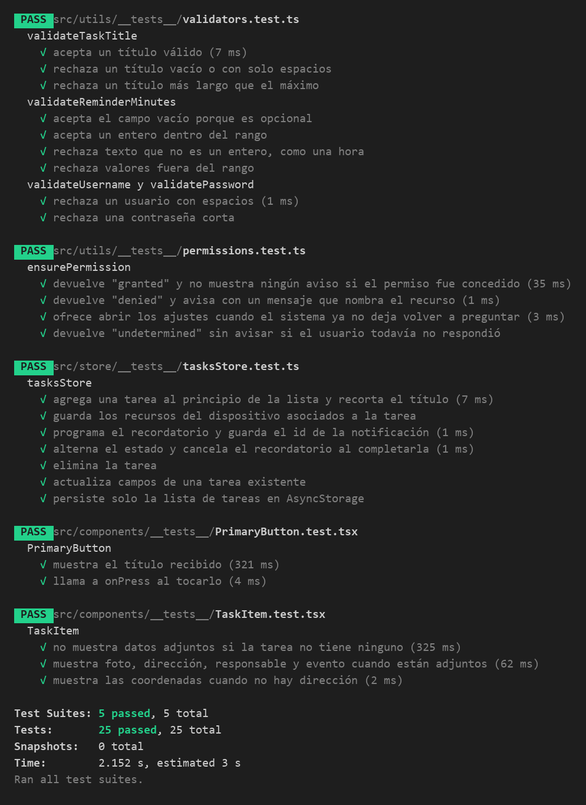

# Gestor de tareas

Parciales 1 y 2 – Aplicaciones Móviles. App móvil hecha con React Native y Expo (TypeScript).

## Opción elegida

**Gestor de tareas.**

## Novedades del Parcial 2

- **Permisos:** se pide cada permiso justo antes de usar el recurso. Se manejan los estados concedido, denegado y pendiente. Si el permiso se rechaza, se muestra un mensaje claro y, cuando el sistema ya no permite volver a preguntar, se ofrece abrir los ajustes de la aplicación.
- **Cámara y galería** (`expo-image-picker`): se puede sacar una foto o elegir una imagen y adjuntarla a la tarea. La foto se ve en el formulario y como miniatura en la lista.
- **Ubicación** (`expo-location`): se adjunta la ubicación actual a la tarea. Se muestra la dirección aproximada o, si no se pudo obtener, las coordenadas.
- **Contactos** (`expo-contacts`): se elige un contacto de la agenda como responsable de la tarea.
- **Calendario** (`expo-calendar`): al guardar la tarea se puede crear un evento en el calendario del dispositivo, vinculado a ella.
- **Estado global** (Zustand): la lista de tareas se migró a un store con acciones para agregar, eliminar y actualizar. Los componentes leen y modifican el estado mediante selectores. El store guarda las tareas en AsyncStorage con el middleware `persist`.
- **Testing** (Jest y React Native Testing Library): 25 tests sobre el store, el manejo de permisos, las validaciones y los componentes.

Las tareas guardadas con la versión del Parcial 1 no se migran: el store usa una clave de almacenamiento nueva.

## Cómo ejecutar la app

Requisitos: Node.js (probado con v24) y un celular Android. El celular y la computadora deben estar en la misma red WiFi.

La app usa el calendario del dispositivo, que no está disponible en Expo Go. Por eso se ejecuta con una **build de desarrollo** (dev client):

1. Instalar en el celular la APK de desarrollo: <https://expo.dev/artifacts/eas/B2W0swsboY-HnfXPGX-AqOElxOvtxsCaDwktGiRoT6Y.apk> (disponible hasta 30/11/2026)
2. En la carpeta del proyecto:

```bash
npm install
npx expo start --dev-client
```

3. Abrir la app instalada y escanear el código QR que aparece en la terminal.

## Cómo correr los tests

```bash
npm test
```

## Funcionalidades del Parcial 1

- **Registro e inicio de sesión local** con usuario y contraseña, guardados en AsyncStorage. La sesión se mantiene al cerrar la app y no se puede acceder a las tareas sin iniciar sesión.
- **Tareas:** crear, listar, marcar como hechas (se tachan) y eliminar. Los datos se conservan al cerrar la app.
- **Recordatorio opcional:** al crear una tarea se puede indicar en cuántos minutos avisar. Se programa una **notificación local**.
- **Navegación** con React Navigation (Stack): Login, Registro, Home y Alta de tarea.
- **Componentes reutilizables:** `TaskItem` y `PrimaryButton`.

## Estructura del proyecto

```
src/
├── components/   piezas reutilizables (TaskItem, PrimaryButton)
├── context/      sesión del usuario (AuthContext)
├── navigation/   mapa de pantallas y navegador
├── screens/      pantallas (Login, Registro, Home, Alta)
├── services/     notificaciones locales
├── storage/      acceso a AsyncStorage (usuarios)
├── store/        estado global de las tareas (Zustand)
├── utils/        validaciones y manejo de permisos
└── types.ts      tipos (Task, User)
```

## Videos demo

- Parcial 2: <https://www.youtube.com/shorts/ww1QlAZqcQg>
- Parcial 1: <https://www.youtube.com/watch?v=j3MzlgxIgHs>

## Resultado de los tests


